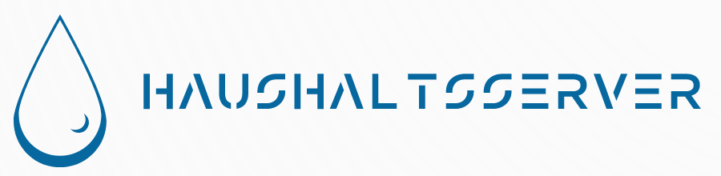
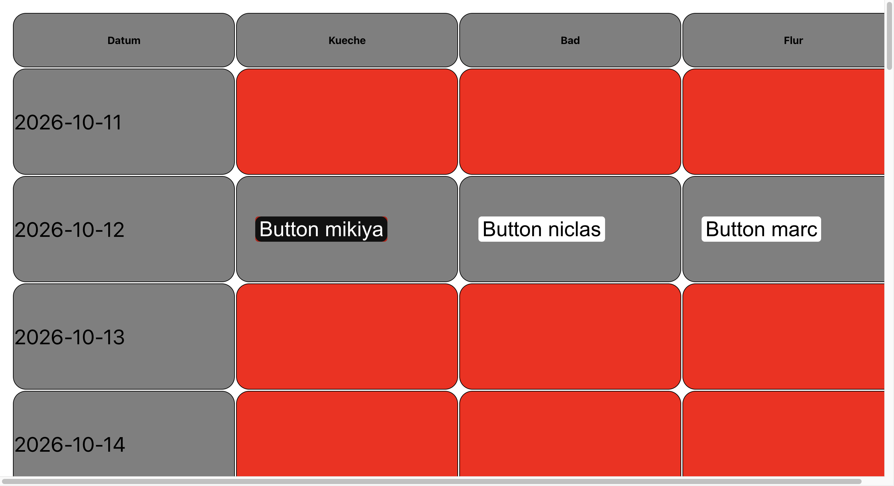

<p align="center">
  
</p>

# Haushaltsserver

A cleaning plan I built for our three-person shared flat (WG). The app rotates kitchen, bathroom and hallway duties, visualises when a room was last cleaned and provides a way to record finished tasks.

The **backend is written in Rust with Rocket**. The UI is a separate [Yew/WebAssembly frontend](https://github.com/niclasdoege/haushaltsplan-fuer-die-rwth-loewen-wg); this repository contains the backend and a compiled copy of the frontend.

**[Try the frontend preview](https://niclasdoege.github.io/haushaltsplan-online-preview/)** · [Frontend source](https://github.com/niclasdoege/haushaltsplan-fuer-die-rwth-loewen-wg) · [Technical details](docs/ARCHITECTURE.md)

## The actual interface



*Captured from the [public frontend preview](https://niclasdoege.github.io/haushaltsplan-online-preview/) on 12 October 2026. This is the real Yew interface, with the preview's old demo records; it is not a connected backend. An [older mobile screenshot (January 2023)](https://github.com/niclasdoege/haushaltsplan-fuer-die-rwth-loewen-wg/blob/main/Screenshot.jpg) shows the date-based colour transition when recent cleaning entries exist.*

There are two views on the main page:

- **Daily room status:** a 14-day grid with one column each for kitchen, bathroom and hallway. Each room's colour is calculated from the cleaning dates in the recorded history: green after cleaning, gradually trending towards red.
- **Weekly cleaning rota:** a 14-week table that rotates the three roommates between the three rooms.

For the current day, a resident can select their assigned room and confirm completion in a dialog. The server stores chore records and supports a separate confirmation workflow.

## Implementation

| Part | Code | Responsibility |
| --- | --- | --- |
| Frontend | [Yew repository](https://github.com/niclasdoege/haushaltsplan-fuer-die-rwth-loewen-wg) | Date grid, colour calculation, weekly rotation, completion dialog and HTTP requests |
| HTTP server | [`src/main.rs`](src/main.rs) | Rocket routes, account handling, chore submissions and confirmation links |
| Notification worker | [`src/notificationservice.rs`](src/notificationservice.rs) | Email confirmations and periodic reminders using Tera and SMTP |
| Persistence | `sqlite.db`, `static/*.json`, `private/pending.json` | SQLite accounts; JSON-based chores and pending requests |

The backend also exposes a LAN-presence check using `arp-scan`. The project was written for a particular household: names, email settings and network configuration are currently part of the source.

The [technical notes](docs/ARCHITECTURE.md) cover the data flow, routes and relevant files.

## Running it locally

This is a historical personal project, **not a turnkey deployment**. The code uses an older Rocket version and requires a nightly Rust feature. A build with today's toolchain has not been verified.

```bash
git clone https://github.com/niclasdoege/haushaltsserver.git
cd haushaltsserver
```

Before attempting to run it, adapt the hard-coded host in `Rocket.toml`, review the credentials and recipients in `src/notificationservice.rs`, and replace the Rocket secret key and household-specific configuration. The notification worker starts with the server: disable it for local experiments unless email has been safely configured.

The historical development command is:

```bash
cargo +nightly run
```

The process expects `static/`, `templates/` and `private/` relative to the repository root. Use non-personal fixture data. See [the frontend repository](https://github.com/niclasdoege/haushaltsplan-fuer-die-rwth-loewen-wg) for the Yew source; the precompiled assets are already checked in here.

**Deployment note:** This was made for a private WG. Review the CORS policy, route permissions and confirmation tokens, and rotate any exposed secrets before hosting it publicly. No license file is included.
