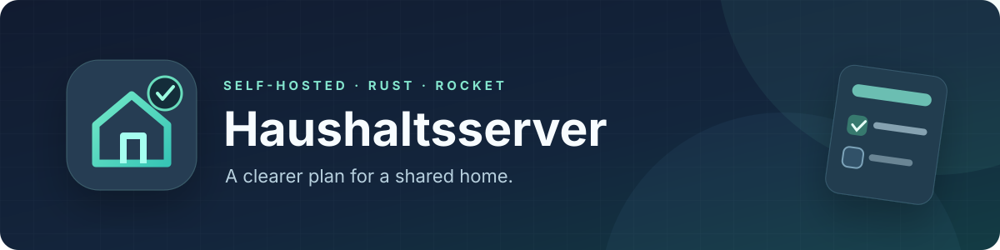
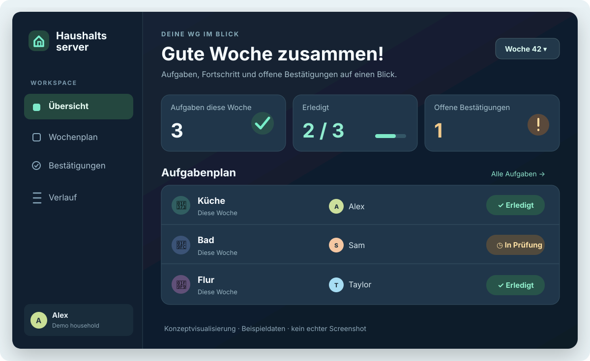
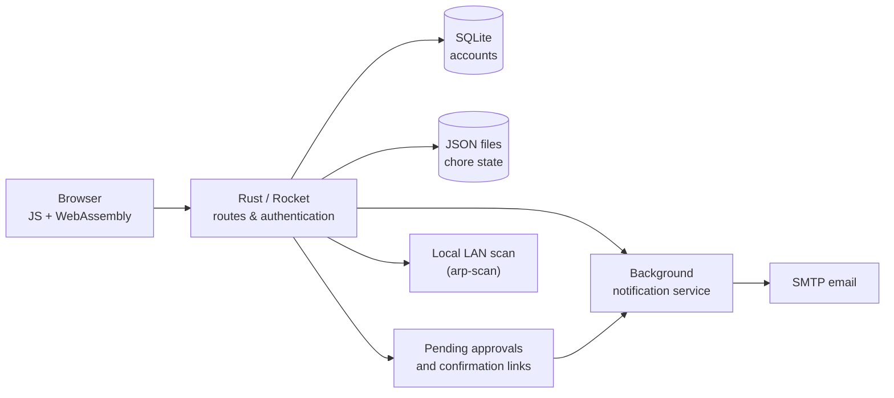

<!-- Project presentation -->
<p align="center">
  
</p>

<h1 align="center">Haushaltsserver</h1>
<p align="center">
  <strong>A small, self-hosted household chore coordinator.</strong><br>
  Weekly responsibilities, completion tracking, confirmations and reminders — built with Rust.
</p>
<p align="center">
  <a href="#what-it-does">Features</a> ·
  <a href="#preview">Preview</a> ·
  <a href="#getting-started">Getting started</a> ·
  <a href="docs/ARCHITECTURE.md">Architecture</a> ·
  <a href="docs/SCREENSHOTS.md">Screenshots</a>
</p>

> **Project status:** A personal/experimental project with legacy dependencies and household-specific configuration. This repository is **not a ready-to-deploy, security-audited service**. See [Before you deploy](#before-you-deploy).

## The idea

A shared flat works better when everybody knows whose turn it is. **Haushaltsserver** brings a weekly cleaning rota and its follow-up workflow together in a browser: assign chores, record completions, request confirmation and send email reminders.

The backend is a [Rocket](https://rocket.rs/)-based Rust service; the checked-in frontend is a prebuilt JavaScript/WebAssembly application.

## What it does

| | Capability | Implementation |
| :-- | :-- | :-- |
| 📅 | **Weekly chore rota** | Tracks kitchen, bathroom and hallway/entrance assignments across weeks. |
| ✅ | **Completion history** | Stores dated task records and derives the last recorded cleaning dates. |
| ✉️ | **Confirmation workflow** | Supports pending submissions and approval links sent by email. |
| 🔔 | **Reminders** | A background service checks for overdue or unconfirmed chores and prepares notification emails. |
| 🙋 | **Accounts and sign-in** | Rocket Auth with a local SQLite user database. |
| 🏠 | **Local presence check** | Optional LAN device detection using `arp-scan`; tied to the original household setup. |

Not all workflows are generic or configurable through the interface. In particular, the original household members, email settings, network addresses and some startup settings are specified in source files.

## Preview



*An **illustrative design mockup**, not a captured screenshot of the current WebAssembly frontend. It shows the concepts in this repository without exposing personal household records.*

The repository already contains [an existing image](static/Haushaltsserver.png) and [an earlier version](static/Haushaltsserver_old.png). To replace these with a verified, privacy-safe capture of the running application, see the [screenshot guide](docs/SCREENSHOTS.md).

## How it fits together



Read [Architecture & data flow](docs/ARCHITECTURE.md) for the actual file layout, HTTP routes and runtime assumptions.

## Getting started

**Prerequisites:** Rust/Cargo, a Rust nightly toolchain for this historical codebase, and any system libraries needed by the native Rust dependencies. A Linux host is expected for the optional `arp-scan` feature.

1. Clone the repository:

   ```bash
   git clone https://github.com/niclasdoege/haushaltsserver.git
   cd haushaltsserver
   ```

2. **Review the source and local configuration before launching.** In particular, change the hard-coded listen address in `Rocket.toml` to an interface your machine actually owns (e.g. `127.0.0.1` for local development), and review `src/notificationservice.rs`, the household-specific identities in `src/main.rs` and the Rocket secret-key setup.

3. Install the toolchain and try the backend:

   ```bash
   rustup toolchain install nightly
   cargo +nightly run
   ```

4. Open the configured Rocket address and port in your browser. The repository supplies prebuilt frontend assets in `static/`; no frontend rebuild step is documented here.

**Important:** This is an older Rust/Rocket prototype. A recent nightly toolchain may require dependency or source migrations; a successful current build has **not** been verified. Startup also spawns the background reminder worker. Disable its launch during isolated development if SMTP is not configured or if you do not want notifications sent.

### Project layout

```text
src/
  main.rs                  Rocket routes, authentication and chore actions
  notificationservice.rs   Email confirmations and scheduled reminders
static/                    Prebuilt browser app (JS, WASM, CSS) and state files
templates/                 Tera login, confirmation and email templates
private/pending.json       Original pending-request state (tracked in Git)
Cargo.toml                 Rust dependencies
Rocket.toml                Local Rocket server configuration
docs/                      Architecture, visuals and screenshot guidance
```

The code currently reads/writes `static/example.json`, `static/zustande.json`, and `private/pending.json`, and creates/opens a local SQLite database for accounts. Preserve the expected structure if you run it.

## Before you deploy

This repository was developed for a specific household, not hardened for public hosting.

- **Keep it private to your LAN while evaluating.** Authentication, broad CORS behavior and confirmation URLs need a security review before internet exposure.
- **Review and rotate secrets.** SMTP credentials, service URLs, device identifiers and the Rocket encryption key must be moved out of source code before real deployment. Never reuse credentials that were committed to Git.
- **Treat checked-in JSON as sample/history, not live data.** Some tracked state may reflect a former household; replace it with non-personal fixtures for demos.
- **Validate the build and workflows.** There is no verified current CI or automated setup path documented for this historical revision.

See [Security & privacy notes](SECURITY.md) for the remediation checklist.

## Documentation

- [Architecture & data flow](docs/ARCHITECTURE.md)
- [Creating genuine, privacy-safe screenshots](docs/SCREENSHOTS.md)
- [Security & privacy notes](SECURITY.md)

## Contributing and reuse

Issues and PRs are welcome as proposals, but the repository does not currently contain a license file. **Public source code is not automatically an open-source license**; ask the owner for permission before reusing or redistributing it beyond the rights provided by law.
