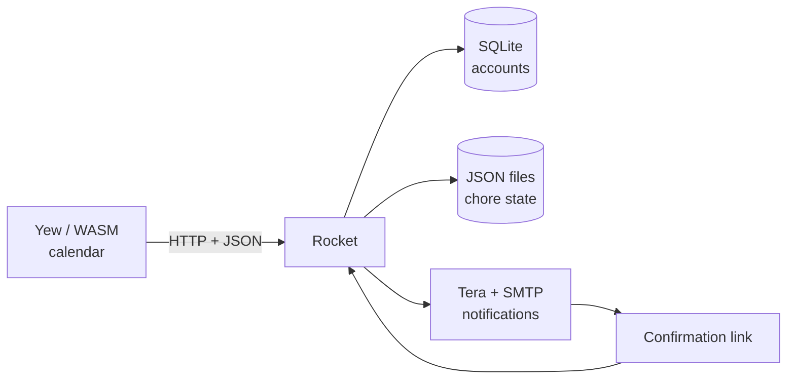

# How Haushaltsserver is built

This project has two source repositories: the [Rocket backend](https://github.com/niclasdoege/haushaltsserver) and the [Yew frontend](https://github.com/niclasdoege/haushaltsplan-fuer-die-rwth-loewen-wg). The backend repo also contains a precompiled WebAssembly build in `static/`.

## Data flow

The browser calculates the daily colour grid and weekly rotation. It requests chore state from the server and submits completion records. Rocket handles authentication and a pending-confirmation flow; a background worker sends reminder and approval emails.

## Important paths

| Path | Role |
| --- | --- |
| `src/main.rs` | HTTP routes, account handling, confirmation links and JSON writes |
| `src/notificationservice.rs` | SMTP sending, pending approvals and periodic reminder checks |
| `static/index.html` and hashed `static/*.{js,wasm,css}` | Compiled Yew frontend |
| `static/example.json` | Recorded chores by week |
| `static/zustande.json` | Derived last-cleaned dates |
| `private/pending.json` | Pending requests and confirmation keys |
| `templates/` | Tera pages and email templates |
| `sqlite.db` | SQLite user database, created when running |

## Selected routes

| Route | Purpose |
| --- | --- |
| `GET /`, `GET /status` | Return the frontend |
| `GET /login`, `POST /login`, `POST /signup`, `GET /logout` | Authentication |
| `GET /whichuser` | Map a signed-in user to a household role |
| `POST /tables` | Submit a chore record |
| `POST /tables_pending` | Start a pending approval |
| `GET /affirm_3L/<key>` | Approve a record via a link |
| `GET /Excusemon/<key>`, `POST /post_excuse` | Excuse/response process |
| `GET /reach` | LAN device scan via `arp-scan` |

These routes are application internals, not a documented stable API.

## Current limitations

Configuration still includes the original household's users, network, mail transport and server address. The frontend uses a hard-coded backend URL in its own source. The server uses older Rust dependencies, a nightly-only feature gate, JSON files for concurrent state and an email worker that starts automatically. A new deployment should isolate this configuration, use synthetic fixtures and receive a security review before exposure to the internet.

The [public frontend preview](https://niclasdoege.github.io/haushaltsplan-online-preview/) demonstrates the table-based UI, **not** a connected backend.
