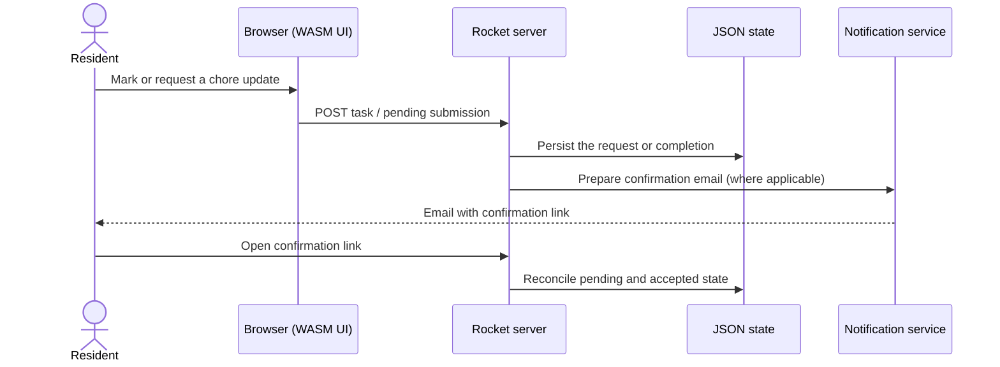

# Architecture & data flow

This is a description of what the checked-in code currently does, **not** a deployment blueprint or a claim that the project builds on modern toolchains.

## Components

| Layer | Paths | Responsibility |
| --- | --- | --- |
| Browser | `static/index.html`, hashed `.js`, `.wasm` and `.css` files | Prebuilt WebAssembly/JavaScript UI for the chore plan. The frontend's source project is not included here. |
| HTTP server | `src/main.rs` | Rocket routes, login/signup, task updates, pending confirmation handling and static file delivery. |
| Accounts | `rocket_auth`, `sqlite.db` at runtime | User/session storage in SQLite. |
| Task state | `static/example.json`, `static/zustande.json` | JSON-based completion records and last-done information. |
| Pending workflow | `private/pending.json` | Pending confirmations and one-time-looking numeric keys. |
| Notifications | `src/notificationservice.rs`, `templates/email/` | Tera-rendered email messages, SMTP delivery and periodic reminders. |
| Presence | `GET /reach` | Checks configured LAN devices by invoking `sudo arp-scan`. |

## High-level flow

The background notification worker separately checks stored chore state on an interval.

## Selected HTTP endpoints

These are implementation details; they are **not** presented as a stable external API.

| Route | Purpose |
| --- | --- |
| `GET /`, `GET /status` | Serve the prebuilt browser UI. |
| `GET /login`, `POST /login`, `POST /signup`, `GET /logout` | Account flow via Rocket Auth. |
| `GET /whichuser` | Map an authenticated account to configured household roles. |
| `POST /tables` | Submit a task/completion record (requires a user). |
| `POST /tables_pending` | Submit a pending chore action (requires a user). |
| `GET /affirm_3L/<key>` | Confirmation by a generated link key. |
| `GET /Excusemon/<key>`, `POST /post_excuse` | Excuse/response workflow. |
| `GET /reach` | LAN presence check, host-dependent. |

## Local development gotchas

1. `Rocket.toml` binds to a particular private-network address by default; change it before starting on a different machine.
2. `main.rs` uses unstable Rust features; expect a nightly toolchain and potentially source/dependency updates.
3. The browser app is a compiled artifact. Changes to the frontend require its **separate source/build pipeline**, which is not present in this repository.
4. The server uses relative paths. Run from the repository root so it can find `static/`, `templates/` and `private/`.
5. Account storage is SQLite, but chore and pending data are written into JSON files under version-controlled paths.
6. Startup launches the notification worker. Do not run against real credentials or household data without checking what emails it can send.
7. `arp-scan` assumes a local Linux-style networking setup and elevated execution rights; it will not work unmodified on every host.

## Boundaries and future improvements

If this is revived as an actively deployed app, useful next steps would be: environment-driven configuration; a separate example-data directory; secret and private-data cleanup; authentication/authorization review; structured persistence and migrations; frontend source/build documentation; reproducible CI; and real screenshots captured from sanitized fixtures.

See [SECURITY.md](../SECURITY.md) before publishing a live demo.
